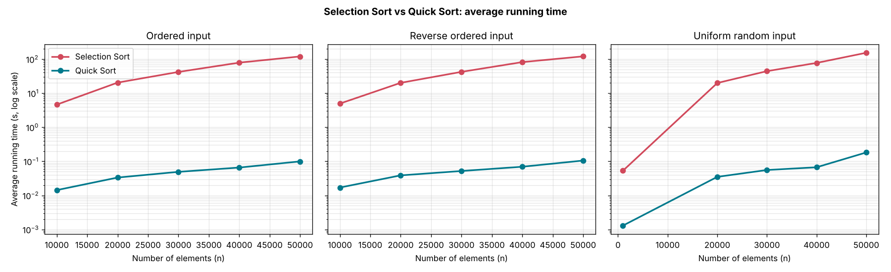
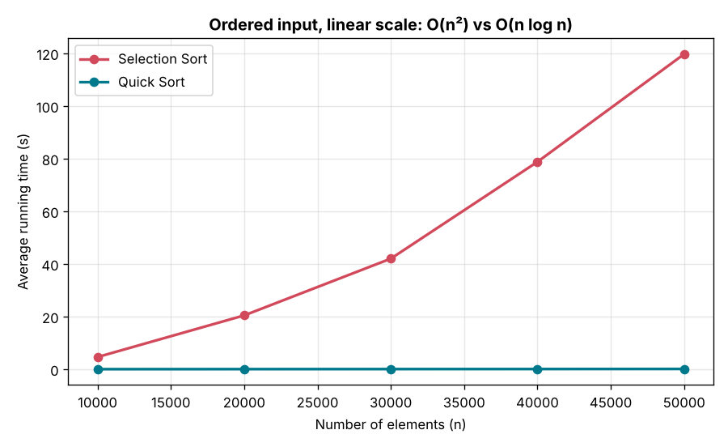

# ⚙️ Algorithms Analysis & Design: Sorting and Shortest Path

An experimental study of algorithms in two phases:

1. **Sorting:** Selection Sort vs Quick Sort (divide and conquer), timed on ordered, reverse-ordered and random inputs.
2. **Shortest path finding:** Breadth-First Search (BFS) vs Depth-First Search (DFS) on random unweighted graphs.

> Course project for **CS412: Algorithms Analysis and Design**, Imam Abdulrahman Bin Faisal University (IAU), 2024–2025.
> Implemented in **Python**.

<p align="center">
  
</p>

---

## 📊 Phase 1: Sorting (Selection Sort vs Quick Sort)

**Goal:** Implement two sorting algorithms, one of them from the divide-and-conquer family, and compare them both theoretically and experimentally.

| | Selection Sort | Quick Sort |
|---|---|---|
| Design technique | Brute force | Divide and conquer |
| Best case | O(n²) | O(n log n) |
| Average case | O(n²) | O(n log n) |
| Worst case | O(n²) | O(n²) (bad pivot) |
| Extra space | O(1) | O(log n) recursion stack |

**Datasets:** floating-point arrays of size **10,000 to 50,000** in three input orders:
- **Ordered:** 1, 2, 3, …, n
- **Reverse ordered:** 100000, 99999, …
- **Uniform random:** random floats

Every size was run several times and the best, worst and average times were recorded.

### Average running time (seconds)

| n | Selection: ordered | Quick: ordered | Selection: reverse | Quick: reverse | Selection: random | Quick: random |
|---|---|---|---|---|---|---|
| 10,000 | 4.62 | 0.0143 | 4.95 | 0.0170 | – | – |
| 20,000 | 20.43 | 0.0334 | 20.14 | 0.0387 | 19.90 | 0.0350 |
| 30,000 | 42.00 | 0.0491 | 42.27 | 0.0520 | 44.32 | 0.0556 |
| 40,000 | 78.76 | 0.0656 | 81.73 | 0.0694 | 77.28 | 0.0669 |
| 50,000 | 119.68 | 0.0995 | 120.43 | 0.1053 | 153.46 | 0.1820 |

(The random-input runs used n = 1,000 instead of 10,000 for the first size. All values are in [`sorting_times.csv`](phase1-sorting/results/sorting_times.csv).)

### Findings
- At 50,000 elements, **Quick Sort is about 1,000× faster** than Selection Sort on every input type.
- When n doubles from 20,000 to 40,000, Selection Sort's time roughly **quadruples** (20 s → 79 s), which matches **O(n²)**. Quick Sort's time roughly **doubles**, which matches **O(n log n)**.
- Selection Sort's time hardly changes with the input order, because it always scans the whole unsorted part.

<p align="center">
  
</p>

## 🧭 Phase 2: Shortest Path Finding (BFS vs DFS)

**Problem:** Find the shortest path between two vertices in an **unweighted** graph.

| | BFS | DFS |
|---|---|---|
| Data structure | Queue | Stack |
| Explores | Level by level | As deep as possible first |
| Guarantees shortest path? | ✅ Yes (unweighted graphs) | ❌ No, it returns *a* path |
| Time complexity | O(V + E) | O(V + E) |
| Space complexity | O(V) | O(V) |

Both algorithms record each node's **parent** while traversing, then backtrack from the target to rebuild the path.

### Experiments
- **Random character graph:** vertices named A–Z, AA, AB, …, with 100 vertices and 300 edges.
- **Random number graph:** integer vertices, from small graphs up to 1,000 vertices and 8,000 edges.
- **Small hand-made graphs:** graphs with 6 vertices, used to check that the code is correct.

For each run, the code reports the path found, the execution time, the memory used by the graph, and the complexity O(V + E) with the actual V and E.

### Sample results (from the report)

| | BFS (example 1) | DFS (example 1) | BFS (example 2) | DFS (example 2) |
|---|---|---|---|---|
| Path length (vertices) | **3** | 11 | **4** | 20 |
| Time | 0.000073 s | 0.000132 s | 0.000250 s | 0.000041 s |
| Shortest path? | ✅ | ❌ | ✅ | ❌ |

*Random character graph, 100 vertices and 300 edges.*

**Conclusion:** BFS always found the shortest path. DFS was sometimes faster, but it often returned longer paths. For shortest-path problems on unweighted graphs, BFS is the right choice. DFS fits better when any valid path is enough or memory is limited.

## ▶️ Run the code

```bash
pip install -r requirements.txt
cd phase2-shortest-path/code

python bfs_dfs_small_examples.py   # two small fixed graphs
python bfs_dfs_char_graph.py       # random character graph (100 vertices, 300 edges)
python bfs_dfs_number_graph.py     # random number graph (1,000 vertices, 8,000 edges)
python bfs_dfs_networkx.py         # draws a random graph with NetworkX + matplotlib
```

The number of vertices and edges can be changed at the bottom of each script.

## 📁 Repository structure

```
.
├── docs/
│   └── phase2-shortest-path-report.pdf   # Full report: theory, pseudocode, complexity tables, results
├── phase1-sorting/
│   ├── results/
│   │   ├── sorting_times.csv             # All timings (best / worst / average)
│   │   └── excel/                        # Original timing sheets with charts
│   └── figures/
├── phase2-shortest-path/
│   ├── code/
│   │   ├── bfs_dfs_small_examples.py
│   │   ├── bfs_dfs_char_graph.py
│   │   ├── bfs_dfs_number_graph.py
│   │   └── bfs_dfs_networkx.py
│   └── results/
│       └── small-examples-comparison.xlsx
├── requirements.txt
└── README.md
```

---

<details>
<summary>🇸🇦 ملخص بالعربي</summary>

مشروع مادة **تحليل وتصميم الخوارزميات (CS412)**، وفيه مرحلتين:

**١. الترتيب:** قارنّا بين Selection Sort وQuick Sort (من عائلة فرّق تسد) على بيانات مرتبة، ومرتبة بالعكس، وعشوائية، بأحجام من ١٠ آلاف إلى ٥٠ ألف عنصر. عند ٥٠ ألف عنصر كان Quick Sort أسرع بحوالي ١٠٠٠ مرة. ولما يتضاعف حجم البيانات يتضاعف وقت Selection Sort تقريباً ٤ مرات، وهذا يطابق O(n²).

**٢. أقصر مسار:** قارنّا بين BFS وDFS لإيجاد أقصر مسار في رسم بياني غير موزون، على رسوم عشوائية بحروف وأرقام. BFS يلقى أقصر مسار دايماً. DFS أحياناً أسرع، بس يرجّع مسارات أطول.
</details>
